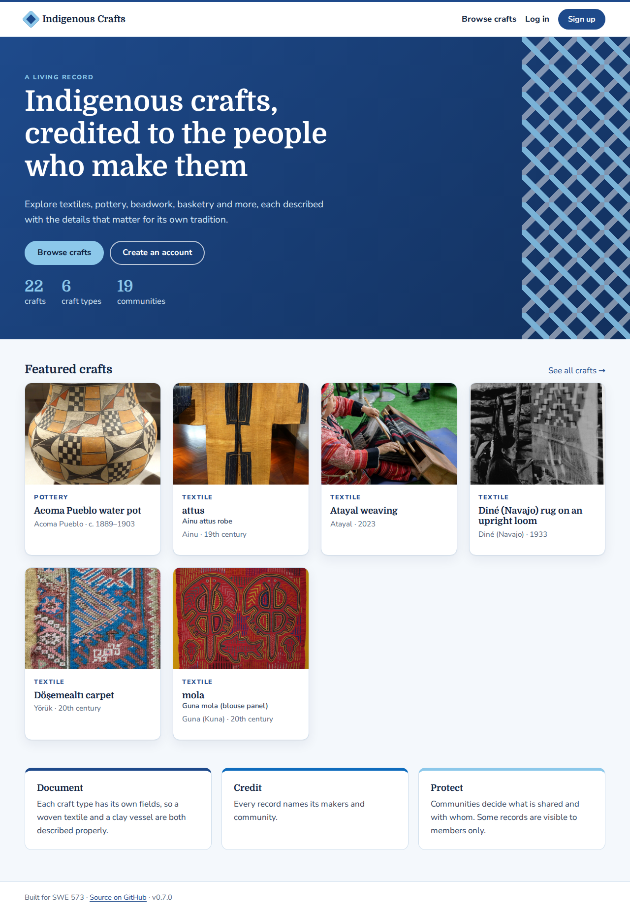

# SWE573-2025719006: Indigenous Crafts Platform

A website to document and showcase Indigenous crafts. Registered users can record crafts with attributes specific to each craft type (textiles, pottery, beadwork, basketry, carving, …). Makers and communities are credited, and community cultural protocols are respected: consent, visibility levels and steward review.

| | |
|---|---|
| **Author** | Ege Güçlü Asan |
| **Course** | SWE 573, 2026/2027-1, Suzan Üsküdarlı |
| **Stack** | Python 3.12 · Django 5.2 LTS · PostgreSQL 16 · server-rendered templates · pytest + Playwright ([ADR-001](docs/adr/001-tech-stack.md)) |
| **Timeline** | 12 Oct – 26 Nov 2026: complete with M4 ([v0.8.0](https://github.com/bakalit01/SWE573-2025719006/releases/tag/v0.8.0)); final presentation by 20 Dec |

## Project status
**The project is complete: M4 – Enrich is the final milestone, shipped on 26 Nov 2026 in [release v0.8.0](https://github.com/bakalit01/SWE573-2025719006/releases/tag/v0.8.0).** On 26 Nov the scope was closed at M4: M5 (hardening, performance, final handover) and three M4 stories (US-21 sensitive photos, US-26 TK labels, US-29 accessibility audit) were dropped. See [Project plan §1](docs/PROJECT_PLAN.md#1-milestones).

M4 added:
- **Craft types in the admin** (US-13): admins add craft types and add, reorder and retire their fields without a code change; edits that would break stored values are refused
- **Names in other languages** (US-10): the community's own name is shown first; search finds every name and ignores accents ("dosemealti" finds Döşemealtı)
- **Favourites and collections** (US-18): members save crafts with ♡ and group them into named collections, private unless shown on their profile; crafts they can no longer see drop out
- **Managed taxonomies** (US-28): regions become managed terms; materials, techniques, communities and regions have alternate spellings that search uses; admins merge duplicates without losing links to crafts
- **Filters for a craft type's own fields** (US-19): choose a craft type and filter by its choice, yes/no and number fields, e.g. dye source or threads per cm

**M3 – MVP delivered on 2 Nov 2026, six days early: [release v0.6.0](https://github.com/bakalit01/SWE573-2025719006/releases/tag/v0.6.0).** Roles (member, maker, community steward, admin) with logged role changes; four visibility levels enforced on every page, in search and on photo URLs; search, filters and sorting; consent records and steward review; report or request removal on every craft page; community pages; members' stories and search by location ([v0.6.1](https://github.com/bakalit01/SWE573-2025719006/releases/tag/v0.6.1)).

Earlier: M2 Contribute (25 Oct, [v0.4.0](https://github.com/bakalit01/SWE573-2025719006/releases/tag/v0.4.0)) and feedback rounds FB-01–FB-11 (22 real examples, Boğaziçi colours, "Other" choices and tags, stories, location search); admin login on the live site fixed ([v0.6.2](https://github.com/bakalit01/SWE573-2025719006/releases/tag/v0.6.2)). A first M4 release on 16 Nov ([v0.7.0](https://github.com/bakalit01/SWE573-2025719006/releases/tag/v0.7.0), [v0.7.1](https://github.com/bakalit01/SWE573-2025719006/releases/tag/v0.7.1)) was withdrawn the same day and replaced by v0.8.0.

| Milestone | Due | Deliverable |
|---|---|---|
| [M1 – Running demo](https://github.com/bakalit01/SWE573-2025719006/milestone/2) | ✅ 13 Oct (week 1) | Browse sample crafts, craft page, sign up / log in / log out |
| [M2 – Contribute](https://github.com/bakalit01/SWE573-2025719006/milestone/3) | ✅ 25 Oct (week 2) | Add/edit crafts with photos, craft-type-specific fields, profiles |
| [M3 – MVP](https://github.com/bakalit01/SWE573-2025719006/milestone/4) | ✅ 2 Nov (week 4) | Search & filter, roles, visibility & consent, steward review, reports, community pages |
| [M4 – Enrich](https://github.com/bakalit01/SWE573-2025719006/milestone/5) | ✅ 26 Nov (week 7) · **final** | Admin-managed craft types, multilingual names, favourites & collections, managed taxonomies, filters by craft-specific fields |
| ~~[M5 – Final product](https://github.com/bakalit01/SWE573-2025719006/milestone/6)~~ | Dropped 26 Nov | Not needed: the project ends with M4 |
| Until 20 Dec | | Final presentation |



## Documentation
| Document | Contents |
|---|---|
| [Project plan](docs/PROJECT_PLAN.md) | Milestones, week-by-week plan, **story sequence** (§3a), tech stack, workflow, risks |
| [Requirements](docs/REQUIREMENTS.md) | Roles, functional & non-functional requirements, data model, ethics |
| [User stories](docs/USER_STORIES.md) | 25 user stories (7 more dropped on 26 Nov), 8 technical tasks and 11 feedback items (FB-01–FB-11) with acceptance criteria and delivery order |
| [Tests](docs/TESTING.md) | Every automated test (277): what it does and the expected result, and how to run them |
| [ADR-001 Tech stack](docs/adr/001-tech-stack.md) | Why Python / Django, hosting on Render |
| [UI design](docs/design/README.md) | Screenshots of every page (desktop and phone) |
| [Changelog](CHANGELOG.md) | What changed in each release |
| [AI acknowledgement](AI_ACKNOWLEDGEMENT.md) | How Claude Opus 5.5 (Medium) was used in this project |
| [Issues](https://github.com/bakalit01/SWE573-2025719006/issues) | One issue per story/task (#24–#63) and per feedback item (#68–#71, #77, #80, #81, #88, #90, #95, #96); [Roadmap #65](https://github.com/bakalit01/SWE573-2025719006/issues/65) is the weekly checklist |

## Getting started

**Requirements:** Python 3.12+, [uv](https://docs.astral.sh/uv/), PostgreSQL 16 (or Docker).

```bash
# Option A: Docker (app + database)
docker compose up --build            # → http://localhost:8000

# Option B: local Python
cp .env.example .env                 # edit DATABASE_URL if needed
uv sync --all-groups
uv run python manage.py migrate
uv run python manage.py seed_reference_crafts  # 22 real examples from public sources
uv run python manage.py seed_sample_data --fictional  # optional: fictional samples used by tests
uv run python manage.py createsuperuser       # for /admin/
uv run python manage.py runserver             # → http://localhost:8000
```

**Tests:** `uv run pytest` (unit + integration); every test is described in [docs/TESTING.md](docs/TESTING.md). For the browser tests, first run `uv run playwright install chromium`.

**Deploy (Render, free tier):** in Render choose **New → Blueprint**, then pick this repository. `render.yaml` creates the web service and the PostgreSQL database, then runs migrations and loads the real examples on start (crafts added by users are kept). To get into `/admin/` on the live site, set `DJANGO_SUPERUSER_EMAIL` and `DJANGO_SUPERUSER_PASSWORD` under the service's **Environment**; then log in at `/admin/` with exactly those values (capital letters in the email don't matter). The account is created or repaired at that moment, and on every start-up, so to reset a forgotten password, change the variable and redeploy. The deploy log shows a line starting with `ensure_admin:`, and the page footer shows which commit is live.

**If a deploy fails:** open the service's **Logs** in Render and look for the first error. Render's free PostgreSQL database expires 30 days after it is created (then 14 days' grace before it is deleted); after that, start-up fails at `migrate` with a database connection error. Create a new free database (or upgrade the old one), put its *Internal Database URL* in the web service's `DATABASE_URL`, and redeploy: migrations, the real examples, the label list and the admin account are all recreated on start-up, but crafts added by users are lost with the old database.

### Demo script (M3 MVP)
1. **Browse crafts**, then open a real example (e.g. the Pomo basket by Jenny Hughes). Show the "At a glance" card (made by / from / in, size with its converted value, weight, local measure) and the Materials and Techniques sections.
2. **Sign up** (password ≥ 10 characters), then open **Add a craft**.
3. Pick a **craft type**: its own fields appear under "Craft details". Search a place or click the map to drop a pin; the place name fills in. Add two materials with origins, a technique, a size in inches or cm, and a photo with alt text.
4. Show the flexibility: choose **Other (type your own)** for the community and type a name; for a weight, pick **Other** as the unit and type "okka"; add a row under **Your own details**; add **tags** or click a suggested one. Under **Sharing**, choose a visibility level and fill in the **consent** record.
5. **Submit for review** (a maker's craft waits for the community's stewards; stewards and admins publish directly). The craft page shows everything, with the size converted (the typed weight unit is shown as written). Click a tag to see every craft with it. Click **Edit**, change the year, then **Save as draft**: the record is now visible only to you (**My crafts**).
6. Open your name in the header to see your **maker profile**; **Edit profile** to add a bio and community.
7. Log out, then use **Forgot your password?** on the login page. The reset email appears in the server console in development.
8. **Review as a steward.** In `/admin/`, give a second account the *Community steward* role and add it as a steward of the craft's community (Communities → stewards). Log in as that steward: the header shows **Review** with a count. Open the submitted craft, read the consent record in the review panel, and **approve** or **request changes** with a note. The maker gets an e-mail (shown in the server console in development) and sees the note.
9. **Report** any craft without logging in ("Report" on the craft page). The steward sees it in the review queue and can **Unpublish now**.
10. Open a **community page** from any craft; as its steward, **Edit page** to change the description. Try **Search** on Browse crafts, e.g. "wool", with a country filter, and **Near a place**, e.g. "Antalya" within 250 km.
11. As any signed-in member, open a craft and **Share your story** at the bottom of the page.

### Demo script (M4, v0.8.0)
12. Open the **Hahoe masks**: the Korean name 하회탈 is shown above the title, and "At a glance" lists every name with its language. Search Browse crafts for **dosemealti** or **kara cadir**: accents don't matter.
13. In **Add a craft**, add a name under **Names in other languages** and tick "Show this name first"; it appears above the title on the craft page and on its card.
14. Signed in, open any craft and use the **Save** card: **♡ Add to favourites**, then **Add to a collection** → type a new collection name → **Save**. Open **Saved** in the menu: favourites and collections (private by default; tick "Show on my profile" to share one).
15. On Browse crafts, choose **Craft type: Textile**: a "Textile details" box adds filters for its own fields, e.g. *Dye source* or *Threads per cm* from–to.
16. In `/admin/` → **Craft types**, open *Textile*: add a field (choices one per line), move fields with ↑ ↓, untick **Active** to retire one, and save. The add form changes at once. Try changing a field that stores text to **Number**: it is refused.
17. In `/admin/` → **Materials** (or Techniques, Communities, Regions, Tags): add *Other names or spellings* (search finds them), or tick two duplicates → action **Merge selected into one** → choose which to keep → **Merge**. Every craft link moves to the one kept.

**Adding crafts as an admin:** `/admin/` → Crafts. Names, materials, techniques and photos are inline rows. Craft types and communities that users typed under "Other" can be listed with the **added by** filter in the admin.

**Craft types, regions and terms belong to the admins:** edit them in `/admin/`. The start-up seed only adds missing craft types and fields, and sets a real example community's region only if it has none, so your edits survive redeploys. Retire a field (untick Active) rather than deleting it: retired fields keep their data.

## Working on the backlog
- Branch per issue (`us-11-dynamic-fields`), PR with `Closes #n`, CI must pass. Feedback items get an `FB-xx` issue with the `feedback` label.
- Edit stories in `docs/USER_STORIES.md`. Then **Actions → Seed backlog issues → Run workflow** creates any new ones.
