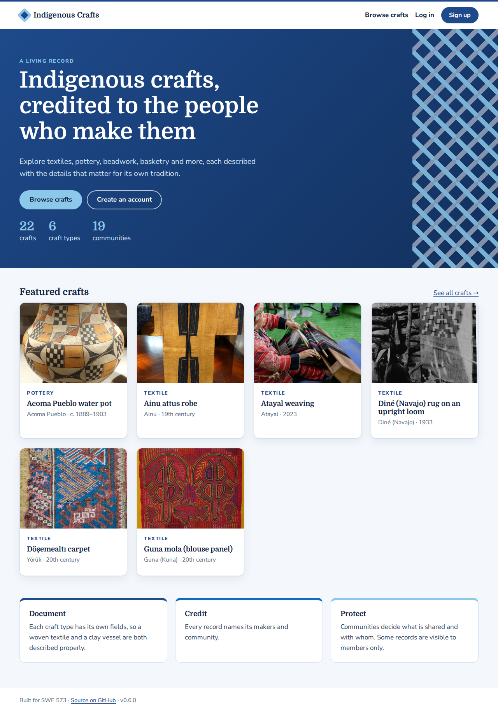

# SWE573-2025719006: Indigenous Crafts Platform

A website to document and showcase Indigenous crafts. Registered users can record crafts with attributes specific to each craft type (textiles, pottery, beadwork, basketry, carving, …). Makers and communities are credited, and community cultural protocols are respected: consent, visibility levels and steward review.

| | |
|---|---|
| **Author** | Ege Güçlü Asan |
| **Course** | SWE 573, 2026/2027-1, Suzan Üsküdarlı |
| **Stack** | Python 3.12 · Django 5.2 LTS · PostgreSQL 16 · server-rendered templates · pytest + Playwright ([ADR-001](docs/adr/001-tech-stack.md)) |
| **Timeline** | 12 Oct – 6 Dec 2026 (feature-complete), buffer to 20 Dec |

## Project status
**M3 – MVP delivered on 2 Nov 2026, six days early: [release v0.6.0](https://github.com/bakalit01/SWE573-2025719006/releases/tag/v0.6.0).** The platform now has everything the MVP promised:

- **Roles**: member, maker, community steward, admin. Admins manage users, roles, stewards and suspensions; changes are logged ([v0.5.0](https://github.com/bakalit01/SWE573-2025719006/releases/tag/v0.5.0))
- **Four visibility levels**: Public, Members only, Community only, Restricted, enforced on every page, in search and on photo URLs
- **Search** across names, text, materials, techniques, communities and tags, with country, material, technique and tag filters and sorting
- **Consent records** and **steward review**: makers submit, the community's stewards approve, request changes or reject; everyone involved is e-mailed
- **Report or request removal** on every craft page, without logging in; stewards can unpublish at once
- **Community pages**, in the community's own words, edited by its stewards
- **Members' stories** on every craft, and **search by location** (near a place or your location, nearest first, on a map) ([v0.6.1](https://github.com/bakalit01/SWE573-2025719006/releases/tag/v0.6.1))

Earlier: M2 Contribute (25 Oct, [v0.4.0](https://github.com/bakalit01/SWE573-2025719006/releases/tag/v0.4.0)) and feedback rounds FB-01–FB-09 (22 real examples, Boğaziçi colours, "Other" choices and tags). Next: user test #1, then **M4 Enrich**.

| Milestone | Due | Deliverable |
|---|---|---|
| [M1 – Running demo](https://github.com/bakalit01/SWE573-2025719006/milestone/2) | ✅ 13 Oct (week 1) | Browse sample crafts, craft page, sign up / log in / log out |
| [M2 – Contribute](https://github.com/bakalit01/SWE573-2025719006/milestone/3) | ✅ 25 Oct (week 2) | Add/edit crafts with photos, craft-type-specific fields, profiles |
| [M3 – MVP](https://github.com/bakalit01/SWE573-2025719006/milestone/4) | ✅ 2 Nov (week 4) | Search & filter, roles, visibility & consent, steward review, reports, community pages |
| [M4 – Enrich](https://github.com/bakalit01/SWE573-2025719006/milestone/5) | 22 Nov (week 6) | Admin-managed attributes, TK labels, multilingual names, accessibility |
| [M5 – Final product](https://github.com/bakalit01/SWE573-2025719006/milestone/6) | 6 Dec (week 8) | Hardened, documented, tested v1.0 |
| Buffer | 7–20 Dec (weeks 9–10) | Feedback, polish, stretch goals, final presentation |



## Documentation
| Document | Contents |
|---|---|
| [Project plan](docs/PROJECT_PLAN.md) | Milestones, week-by-week plan, **story sequence** (§3a), tech stack, workflow, risks |
| [Requirements](docs/REQUIREMENTS.md) | Roles, functional & non-functional requirements, data model, ethics |
| [User stories](docs/USER_STORIES.md) | 32 user stories, 8 technical tasks and 7 feedback items (FB-01–FB-07) with acceptance criteria and delivery order |
| [ADR-001 Tech stack](docs/adr/001-tech-stack.md) | Why Python / Django, hosting on Render |
| [UI design](docs/design/README.md) | Screenshots of every page (desktop and phone) |
| [Changelog](CHANGELOG.md) | What changed in each release |
| [AI acknowledgement](AI_ACKNOWLEDGEMENT.md) | How Claude Opus 5.5 (Medium) was used in this project |
| [Issues](https://github.com/bakalit01/SWE573-2025719006/issues) | One issue per story/task (#24–#63) and per feedback item (#68–#71, #77, #80, #81); [Roadmap #65](https://github.com/bakalit01/SWE573-2025719006/issues/65) is the weekly checklist |

## Getting started

**Requirements:** Python 3.12+, [uv](https://docs.astral.sh/uv/), PostgreSQL 16 (or Docker).

```bash
# Option A: Docker (app + database)
docker compose up --build            # → http://localhost:8000

# Option B: local Python
cp .env.example .env                 # edit DATABASE_URL if needed
uv sync --all-groups
uv run python manage.py migrate
uv run python manage.py seed_reference_crafts  # 22 real examples from public sources
uv run python manage.py seed_sample_data --fictional  # optional: fictional samples used by tests
uv run python manage.py createsuperuser       # for /admin/
uv run python manage.py runserver             # → http://localhost:8000
```

**Tests:** `uv run pytest` (unit + integration). For the browser tests, first run `uv run playwright install chromium`.

**Deploy (Render, free tier):** in Render choose **New → Blueprint**, then pick this repository. `render.yaml` creates the web service and the PostgreSQL database, then runs migrations and loads the real examples on start (crafts added by users are kept).

### Demo script (M3 MVP)
1. **Browse crafts**, then open a real example (e.g. the Pomo basket by Jenny Hughes). Show the "At a glance" card (made by / from / in, size with its converted value, weight, local measure) and the Materials and Techniques sections.
2. **Sign up** (password ≥ 10 characters), then open **Add a craft**.
3. Pick a **craft type**: its own fields appear under "Craft details". Search a place or click the map to drop a pin; the place name fills in. Add two materials with origins, a technique, a size in inches or cm, and a photo with alt text.
4. Show the flexibility: choose **Other (type your own)** for the community and type a name; for a weight, pick **Other** as the unit and type "okka"; add a row under **Your own details**; add **tags** or click a suggested one. Under **Sharing**, choose a visibility level and fill in the **consent** record.
5. **Submit for review** (a maker's craft waits for the community's stewards; stewards and admins publish directly). The craft page shows everything, with the size converted (the typed weight unit is shown as written). Click a tag to see every craft with it. Click **Edit**, change the year, then **Save as draft**: the record is now visible only to you (**My crafts**).
6. Open your name in the header to see your **maker profile**; **Edit profile** to add a bio and community.
7. Log out, then use **Forgot your password?** on the login page. The reset email appears in the server console in development.
8. **Review as a steward.** In `/admin/`, give a second account the *Community steward* role and add it as a steward of the craft's community (Communities → stewards). Log in as that steward: the header shows **Review** with a count. Open the submitted craft, read the consent record in the review panel, and **approve** or **request changes** with a note. The maker gets an e-mail (shown in the server console in development) and sees the note.
9. **Report** any craft without logging in ("Report" on the craft page). The steward sees it in the review queue and can **Unpublish now**.
10. Open a **community page** from any craft; as its steward, **Edit page** to change the description. Try **Search** on Browse crafts, e.g. "wool", with a country filter, and **Near a place**, e.g. "Antalya" within 250 km.
11. As any signed-in member, open a craft and **Share your story** at the bottom of the page.

**Adding crafts as an admin:** `/admin/` → Crafts. Materials, techniques and photos are inline rows. Craft types and communities that users typed under "Other" can be listed with the **added by** filter in the admin.

## Working on the backlog
- Branch per issue (`us-11-dynamic-fields`), PR with `Closes #n`, CI must pass. Feedback items get an `FB-xx` issue with the `feedback` label.
- Edit stories in `docs/USER_STORIES.md`. Then **Actions → Seed backlog issues → Run workflow** creates any new ones.
