# UI design

The low-fidelity wireframes (T-06) were replaced by the working pages of the M1 demo. These screenshots are the current UI reference. Later milestones add the pages below the line.

| Page | Desktop / state | Phone (390 px) |
|---|---|---|
| Home | 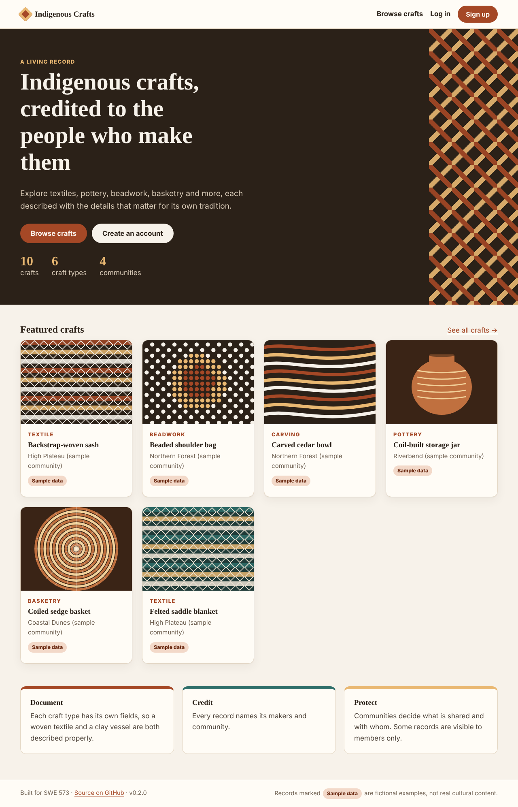 | 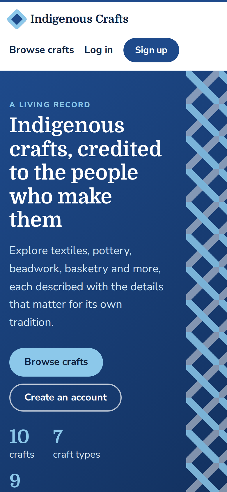 |
| Catalogue (visitor: public crafts only) | 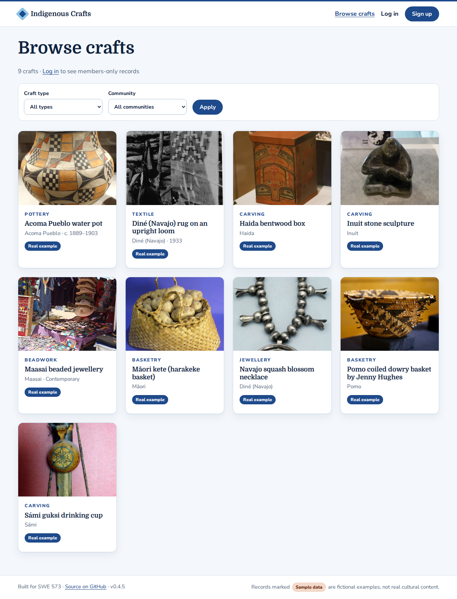 | |
| Craft detail with craft-type details, credits and report link | 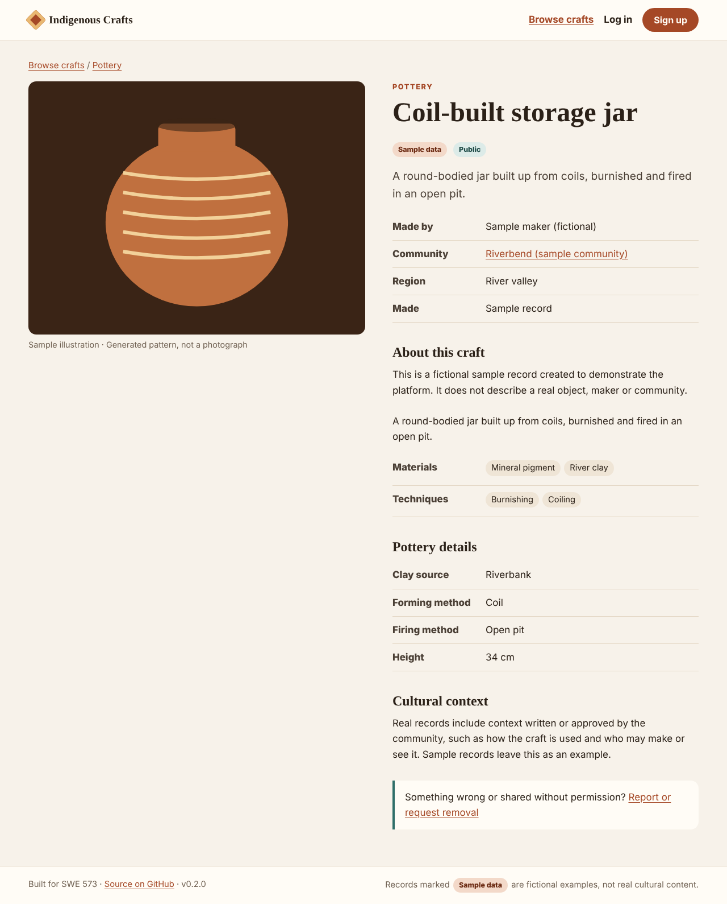 | 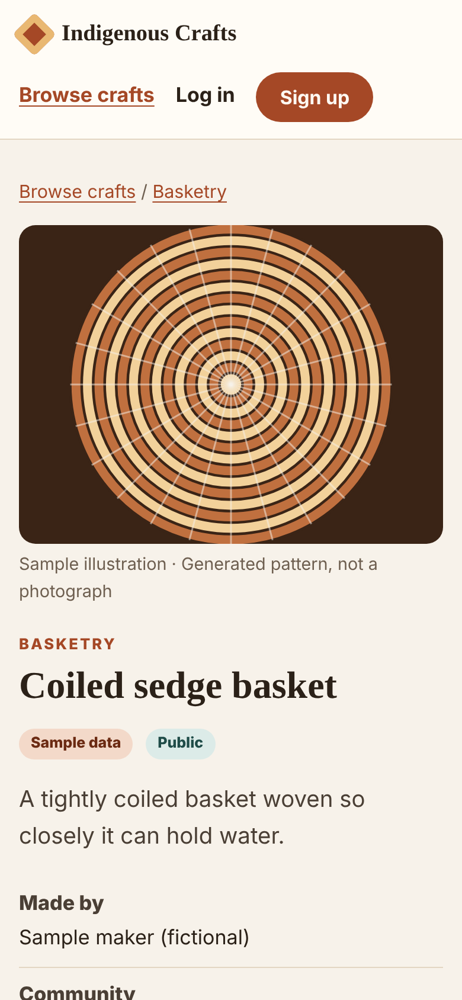 |
| Sign up with validation (password ≥ 10 characters) | 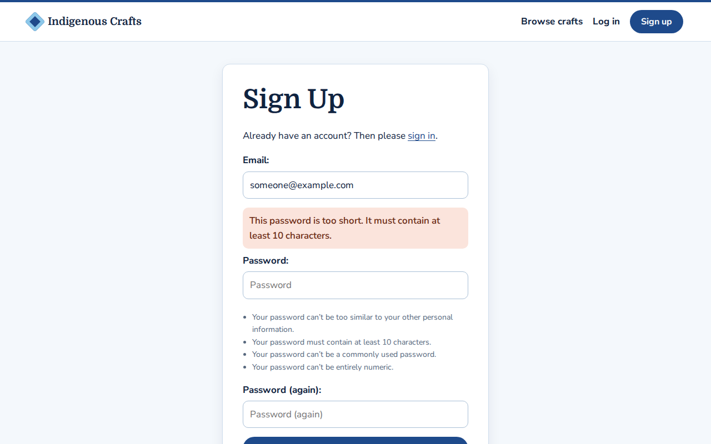 | |
| Signed in: name in header, members-only crafts visible | 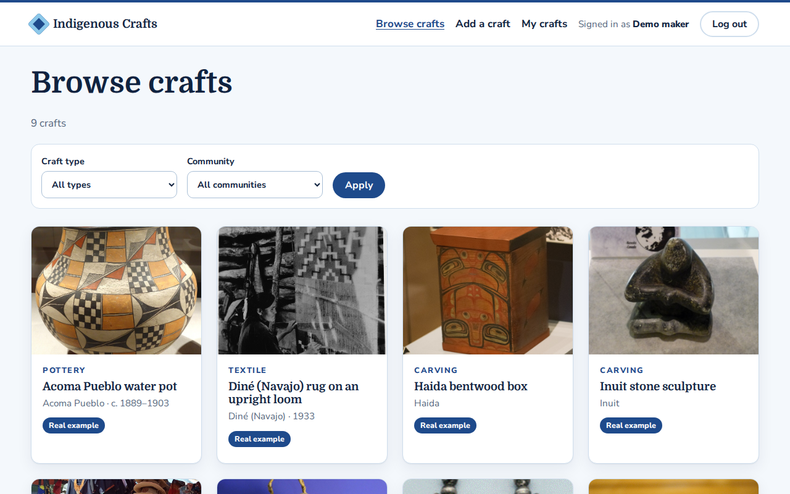 | |
| Login with generic error message | 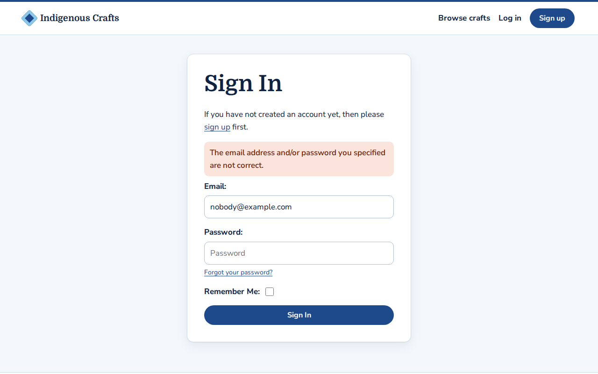 | |

## Colours
Based on Boğaziçi University's corporate identity guide (2020): navy **#1e4a8b** (PANTONE 7686C) as the primary colour, blue **#8cc8ea** (PANTONE 297C) as the secondary. Text is dark navy #0f2340 on blue-white #f4f8fc. Earlier screenshots below show the original earth-tone palette.

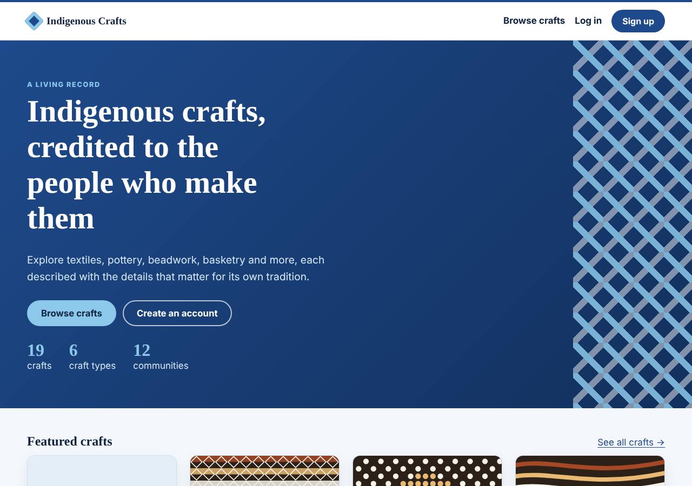

## Layout principles
- **Credit first:** maker and community sit directly under the title on every craft page.
- **Sample data is always labelled.** No real cultural content is shown without consent.
- **Craft-type details** come from the attribute definitions, so each type shows its own fields.
- **Accessible basics:** skip link, visible focus ring, labelled form fields, alt text on every image, AA colour contrast.
- **Low bandwidth:** server-rendered HTML, one CSS file, lazy-loaded images, no JavaScript framework.

## M2: contribute (v0.4.0)

| Page | Screenshot |
|---|---|
| Add a craft: sections, type-specific fields, materials with origin, size with units | 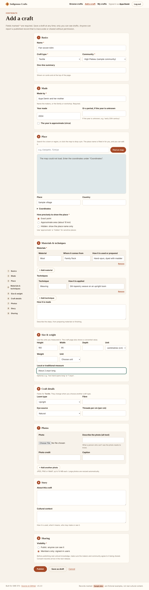 |
| Craft page: gallery, "At a glance" (made by / from / in, size with conversion), materials and techniques in detail | 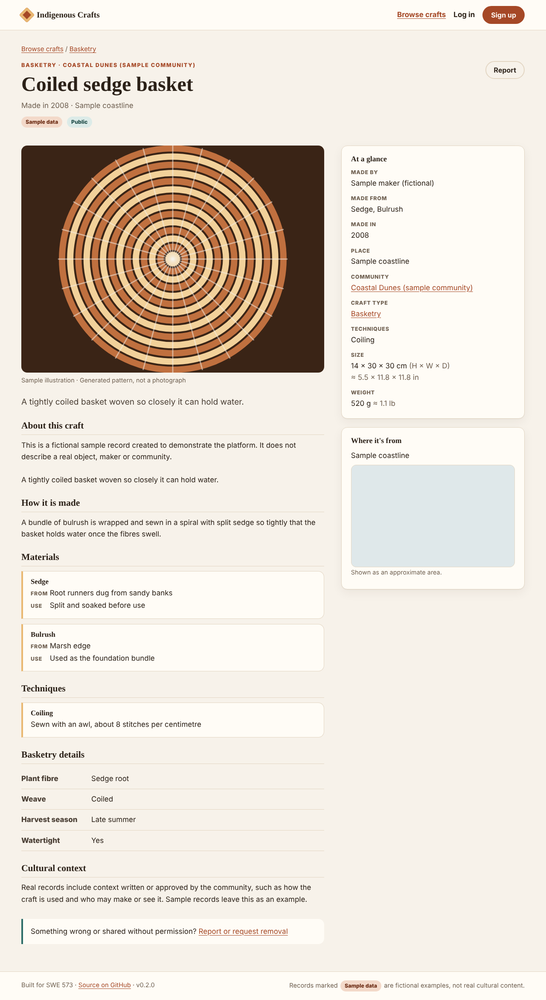 |
| Craft page on a phone: facts card directly under the photo | 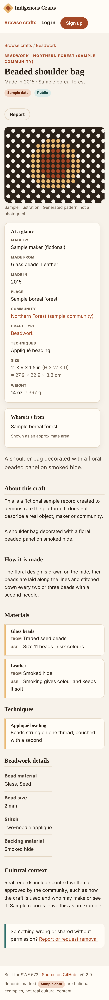 |
| My crafts: drafts and published, edit and delete | 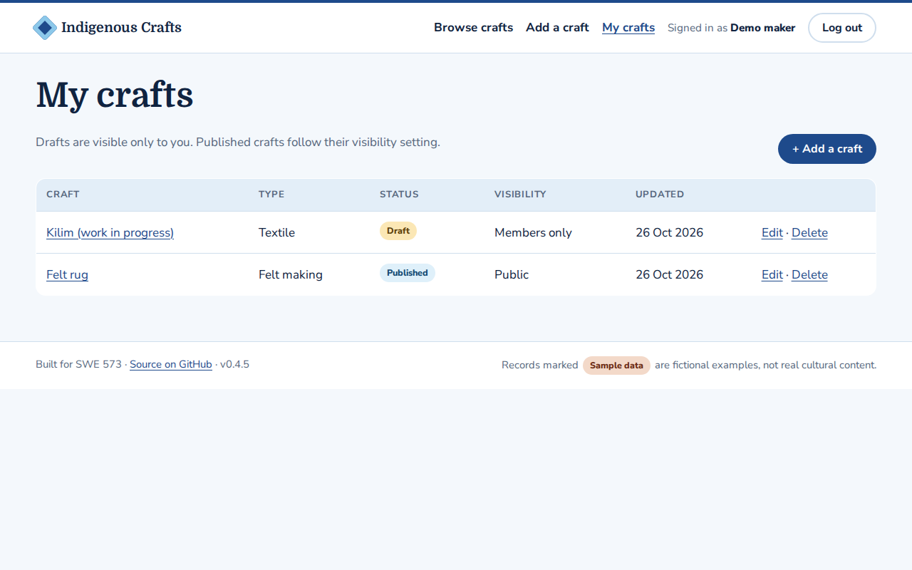 |
| Maker profile | 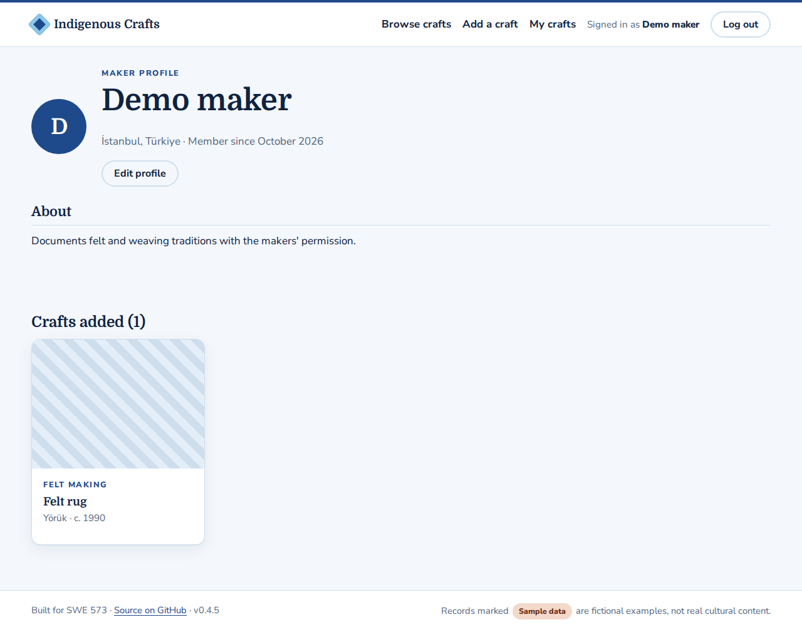 |

The design of the add form and craft page took cues from reference craft-archive sites: a facts sidebar, a location map and a sectioned entry form. It differs in its step navigation, the "Made" summary, materials and techniques with per-row detail, measurements with unit conversion, and privacy controls for places.

Maps use OpenStreetMap tiles through Leaflet, and place search uses Nominatim. If they can't load, the form still works and coordinates can be typed. The screenshots above were taken offline, so the map areas are empty.

---
Next pages (M3–M4): search, roles, consent records, steward review queue, report form.
