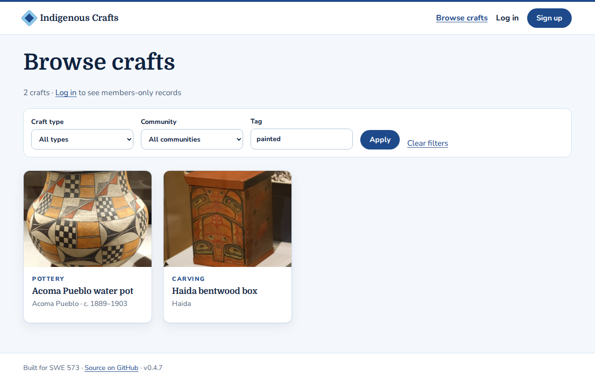
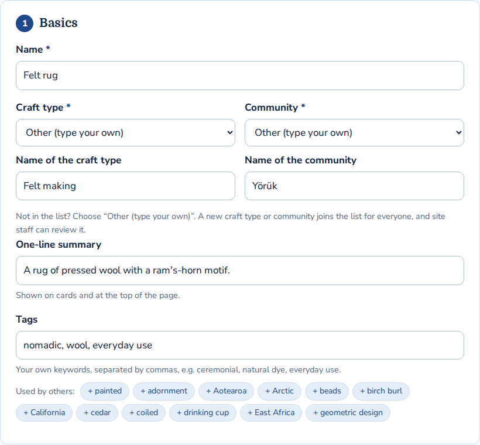
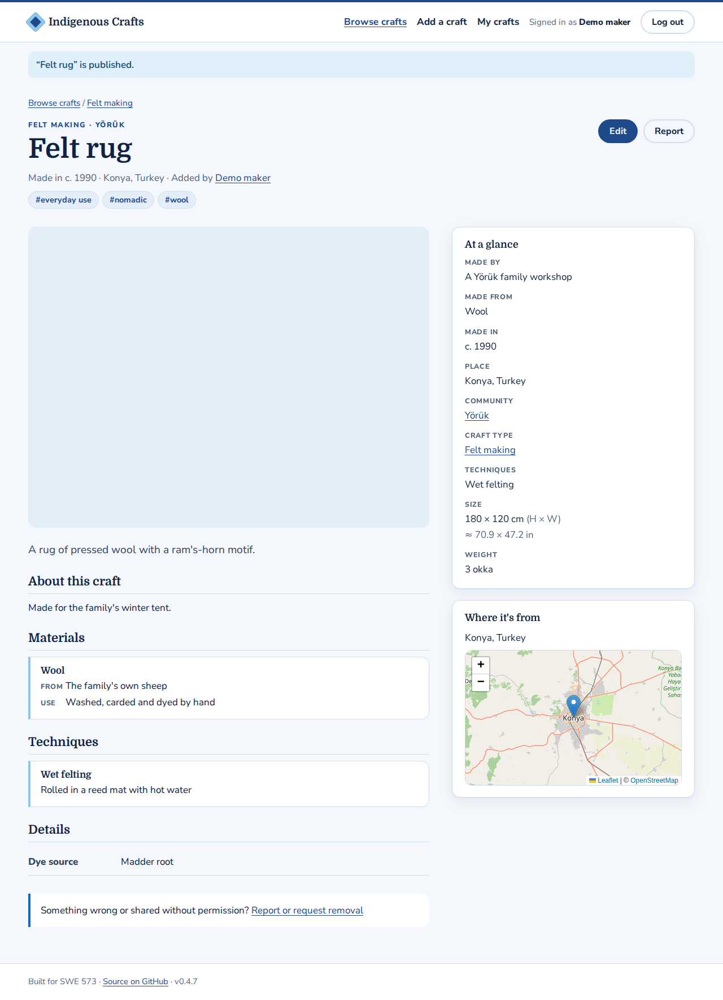

# UI design

The low-fidelity wireframes (T-06) were replaced by the working pages. These screenshots are the current UI reference for **v0.4.5** (26 Oct 2026), with the real examples, their Wikimedia Commons photos and OpenStreetMap maps.

To retake them, push a commit whose message contains `[take screenshots]` to any branch other than `main`, or run the **UI screenshots** workflow by hand. The workflow runs [`scripts/take_screenshots.py`](../../scripts/take_screenshots.py) on GitHub, which can reach Commons and OpenStreetMap, and commits the images to that branch.

## Visitor

| Page | Desktop | Phone (390 px) |
|---|---|---|
| Home: hero, featured real examples, what the site is for |  |  |
| Catalogue: filters by craft type and community |  | |
| Catalogue filtered by a tag (`?tag=painted`); the Tag box suggests tags and also matches part of a tag |  | |
| Craft page: tags, gallery with photo credits and licences, "At a glance", map, materials and techniques in detail, details, sources, report link |  |  |

## Accounts

| Page | Screenshot |
|---|---|
| Sign up with validation (password ≥ 10 characters) |  |
| Login with a generic error message |  |
| Signed in: name in the header, Add a craft and My crafts |  |
| Maker profile with the crafts they added |  |

## Contributing

| Page | Screenshot |
|---|---|
| Add a craft: nine sections, map pin, materials with origin and use, size with units, your own details, photos, sharing |  |
| "Other (type your own)" for craft type and community, and tags with suggestions |  |
| The resulting craft page: new type and community, tags, a typed weight unit ("3 okka", no conversion), own details, map. No photo was added, so the gallery is empty |  |
| My crafts: drafts and published records, edit and delete |  |

## Colours
Based on Boğaziçi University's corporate identity guide (2020): navy **#1e4a8b** (PANTONE 7686C) as the primary colour, blue **#8cc8ea** (PANTONE 297C) as the secondary. Text is dark navy #0f2340 on blue-white #f4f8fc. Red (errors) and amber (drafts) are kept for status.

## Layout principles
- **Credit first:** maker and community sit directly under the title on every craft page, and every photo names its author and licence.
- **Sources shown, no remark badges:** real examples list their Sources and photo credits on the craft page; pages carry no status remarks ("Real example", "Sample data", "Public"), except "Draft" for the author.
- **Nothing forced into a list:** every choice offers "Other (type your own)", and contributors can add their own details and tags.
- **Craft-type details** come from the attribute definitions, so each type shows its own fields.
- **Accessible basics:** skip link, visible focus ring, labelled form fields, alt text on every image, AA colour contrast.
- **Low bandwidth:** server-rendered HTML, one CSS file, lazy-loaded images, no JavaScript framework. The forms work without JavaScript; maps and type-specific fields load on top.

The add form and craft page took cues from reference craft-archive sites: a facts sidebar, a location map and a sectioned entry form. They differ in the step navigation, the "Made" summary, materials and techniques with per-row detail, measurements with unit conversion, and privacy controls for places.

---
Next pages (M3–M4): search, roles, consent records, steward review queue, report form.
